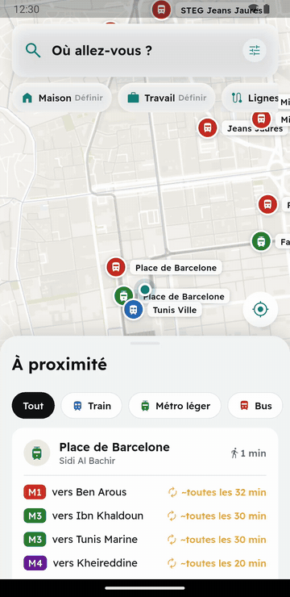
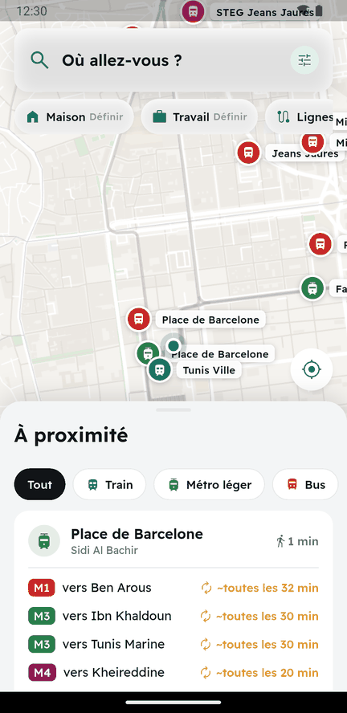
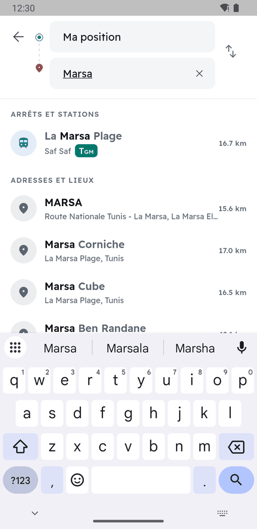
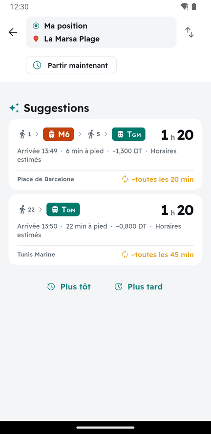
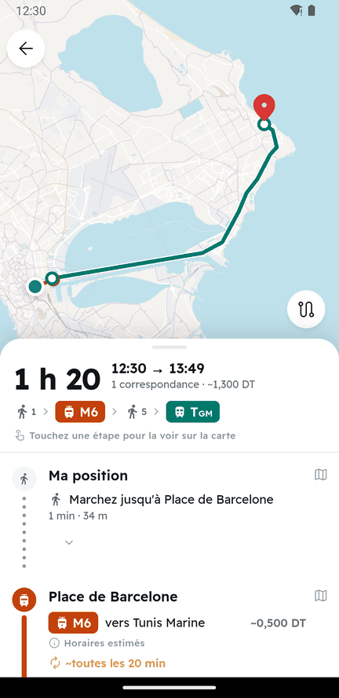
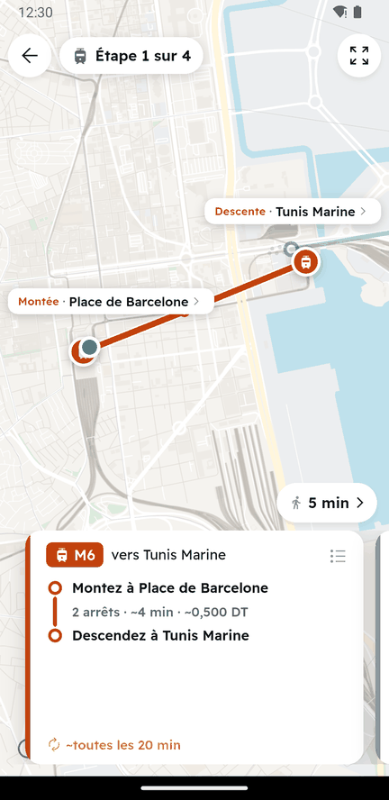
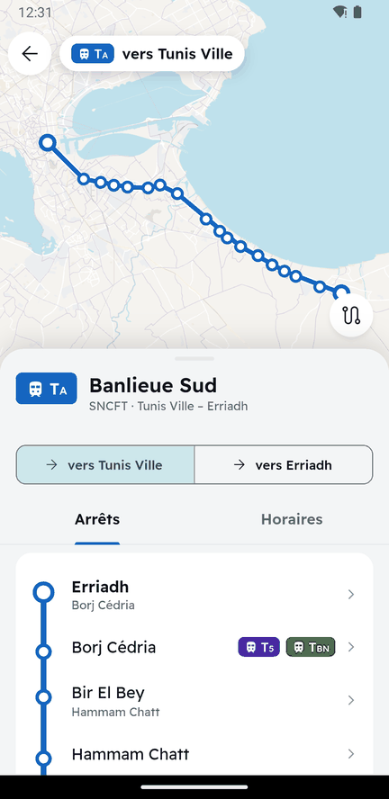
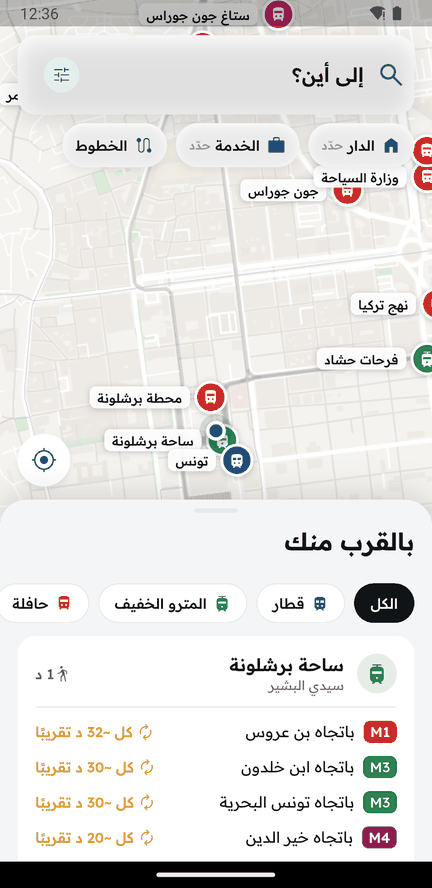
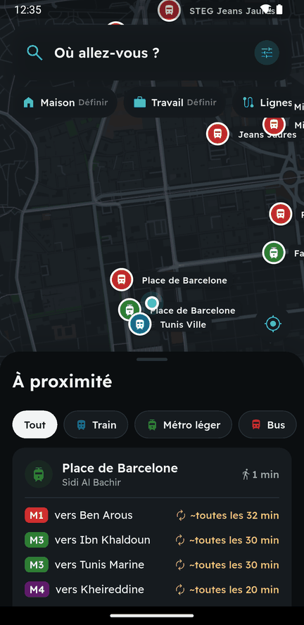
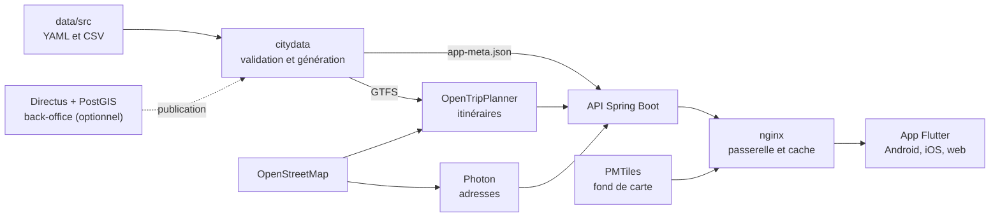

<div align="center">

# Thniya · ثنية

**Se déplacer en Tunisie, simplement : train, métro, bus et cars interurbains, dans une seule application.**

[Français](#à-quoi-ça-sert) · [English summary](#english-summary) · [Démarrer](#démarrer-en-local) · [Contribuer](CONTRIBUTING.md)

[](https://github.com/mohamedelhafi/thniya/actions/workflows/ci.yml)
[](LICENSE)
[](data/LICENSE.md)




</div>

> **Projet indépendant et non officiel.** Thniya n'est ni affilié ni approuvé par la Transtu, la SNCFT, la SNTRI ou le
> ministère du Transport. Une partie des horaires est **estimée** : l'application l'indique clairement.

## À quoi ça sert

En Tunisie, les horaires sont dispersés entre des sites, des affiches et le bouche-à-oreille. Thniya les réunit pour
répondre à une question simple : **comment aller d'ici à là-bas, et combien ça coûte ?**

- **Itinéraires multimodaux** : marche, train, métro léger, TGM, bus, cars interurbains, correspondances et prix.
- **À proximité** : les arrêts autour de vous et leurs prochains passages.
- **Recherche** d'arrêts et d'adresses partout en Tunisie, en français et en arabe.
- **Guidage étape par étape**, avec la carte qui suit chaque étape du trajet.
- **Toutes les lignes** : tracé, arrêts et horaires.
- **Français et arabe** (écran de droite à gauche), **thème clair et sombre**.
- **Honnête sur ses données** : un horaire estimé est toujours signalé comme tel.
- **Autonome** : pas de Google Maps. Carte, itinéraires et géocodage reposent sur des logiciels libres auto-hébergés.

## Captures d'écran

| Accueil | Recherche | Résultats | Trajet |
|:---:|:---:|:---:|:---:|
|  |  |  |  |

| Mode étape | Ligne | En arabe | Thème sombre |
|:---:|:---:|:---:|:---:|
|  |  |  |  |

## Les données

**216 lignes publiées et environ 1 800 arrêts desservis**, sur toute la Tunisie :

| Réseau | Couverture | Horaires |
|---|---|---|
| **SNCFT** | Banlieues, Métro du Sahel, grandes lignes | Publiés par l'opérateur (hiver 2026-2027) |
| **SNTRI** | Cars interurbains | Publiés par l'opérateur (site consulté en octobre 2026) |
| **Transtu** | Métro léger, TGM et bus du Grand Tunis | **Estimés** à partir des fréquences officielles et des distances |
| **Louages** | 103 stations recensées | **Pas encore de lignes** : aucune source fiable sur les durées et fréquences |

Sources, licences et niveaux de fiabilité : [`data/LICENSE.md`](data/LICENSE.md). **Vous connaissez une ligne ? Signalez
une correction**, c'est la contribution la plus utile : voir [CONTRIBUTING.md](CONTRIBUTING.md).

## Comment ça marche



| Dossier | Contenu |
|---|---|
| [`mobile/`](mobile/) | Application Flutter |
| [`backend/`](backend/) | API Spring Boot (`/api/v1`) |
| [`data/`](data/) | Données sources, schémas, générateur Python `citydata`, trajets de référence |
| [`infra/`](infra/) | Docker Compose, nginx, configuration OTP et Photon |
| [`specs/`](specs/README.md) | Spécifications vivantes et décisions d'architecture (ADR) |
| [`docs/images/`](docs/images/) | Captures de ce README |

## Démarrer en local

**Prérequis :** Docker Desktop (8 Go de RAM minimum alloués, environ 5 Go de disque), Flutter 3.47, et Java 21 pour
les tests de l'API.

```bash
git clone https://github.com/mohamedelhafi/thniya.git
cd thniya/infra
cp .env.example .env
```

Modifiez dans `.env` les valeurs `change-me` ; `openssl rand -hex 32` génère un secret.

**1. Préparer la carte, les données et le moteur d'itinéraires** (le premier lancement est long : téléchargements et
construction du graphe)

```bash
docker compose --profile tasks run --rm tools osm-download
docker compose --profile tasks run --rm tools osm-clip
docker compose --profile tasks run --rm tools build
docker compose --profile tasks run --rm tools otp-prepare
docker compose --profile tasks run --rm otp-build
bash scripts/photon-import.sh
```

**2. Récupérer le fond de carte.** Remplacez `AAAAMMJJ` par une date récente de
[maps.protomaps.com/builds](https://maps.protomaps.com/builds/) :

```bash
docker compose --profile tasks run --rm pmtiles extract https://build.protomaps.com/AAAAMMJJ.pmtiles /tiles/tunisie.pmtiles --bbox=7.5,30.2,11.7,37.6 --maxzoom=15
```

**3. Créer les certificats locaux.** Indiquez l'adresse IP de votre PC sur le Wi-Fi :

```bash
docker run --rm -v "$PWD/nginx:/w" -e LAN_IP=192.168.1.20 alpine:3.22 sh /w/make-dev-certs.sh
```

**4. Construire l'app web et démarrer les services**

```bash
(cd ../mobile && flutter build web --profile --pwa-strategy=none)
```

```bash
docker compose -f compose.yml -f compose.local.yml up -d
```

| Adresse | Service |
|---|---|
| http://127.0.0.1:8090 | App web, API et tuiles (développement, sans TLS) |
| http://127.0.0.1:8082/api/v1/docs | Documentation OpenAPI de l'API |
| http://127.0.0.1:8080 | Client de débogage d'OTP |

### Sur Android

Depuis `mobile/`, sur un émulateur :

```bash
flutter run --dart-define=API_BASE_URL=http://10.0.2.2:8090
```

Sur un téléphone branché en USB, redirigez d'abord le port (à refaire après chaque installation ou débranchement) :

```bash
adb reverse tcp:8090 tcp:8090
```

```bash
flutter run --dart-define=API_BASE_URL=http://127.0.0.1:8090
```

### Back-office (optionnel)

Pour saisir les données dans une interface web plutôt que dans les fichiers YAML, voir
[`specs/04d-base-de-saisie.md`](specs/04d-base-de-saisie.md). Il repose sur [Directus](https://directus.io), dont la
licence est à accepter au premier lancement. Ne l'exposez jamais sur Internet.

## Tests

| Partie | Commande | Depuis |
|---|---|---|
| Données | `docker compose --profile tasks run --rm tools lint` | `infra/` |
| Générateur | `docker compose --profile tasks run --rm --entrypoint python tools -m pytest data/scripts/tests -q` | `infra/` |
| Trajets de référence | `docker compose --profile tasks run --rm tools golden` | `infra/` |
| API | `./mvnw test` | `backend/` |
| App | `flutter test` | `mobile/` |

## Feuille de route

- Lignes de louage, à partir de relevés de terrain
- Horaires officiels Transtu arrêt par arrêt, si l'opérateur les publie
- Horaires d'été et de Ramadan de tous les réseaux
- Déploiement public et publication sur les magasins d'applications

Détail : [`specs/12-roadmap.md`](specs/12-roadmap.md).

## English summary

**Thniya** (Tunisian Arabic for "the way") is an independent, open-source multimodal journey planner for Tunisia, in
French and Arabic: trains, light rail, buses and intercity coaches, with self-hosted maps and routing (OpenTripPlanner,
Photon, PMTiles). It is **not an official app**, and Transtu timetables are **estimates**, clearly labelled as such.
The docs and specs are in French. Issues and pull requests are welcome in English, French or Arabic. See
[Démarrer en local](#démarrer-en-local) to run it.

## Licence et remerciements

- **Code :** [Apache 2.0](LICENSE). Composants tiers : [NOTICE](NOTICE).
- **Données de `data/src` :** [ODbL 1.0](data/LICENSE.md), avec les sources et leurs conditions.
- **Carte :** © les contributeurs d'[OpenStreetMap](https://www.openstreetmap.org/copyright), [Protomaps](https://protomaps.com).
- **Merci à** [OpenTripPlanner](https://www.opentripplanner.org), [Photon](https://github.com/komoot/photon),
  [flutter_map](https://github.com/fleaflet/flutter_map) et aux producteurs de données ouvertes tunisiens.
- L'ergonomie s'inspire de Citymapper, sans lien avec cette société.
