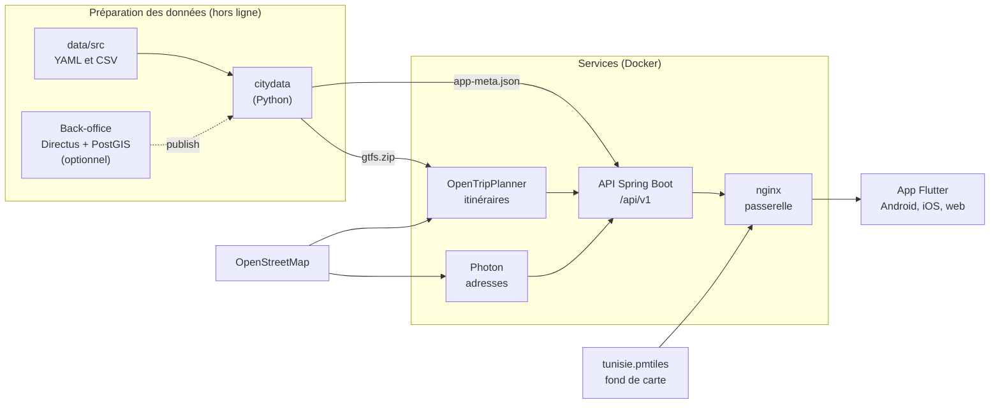
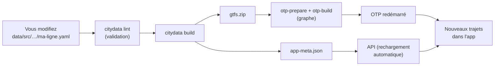

# Architecture

## Vue d'ensemble

## Les briques, une par une

| Brique | Rôle | Techno | Dossier |
|---|---|---|---|
| **Données sources** | Décrire le réseau : arrêts, lignes, horaires, tarifs | YAML, CSV | `data/src` |
| **citydata** | Valider les données et les transformer en GTFS + `app-meta.json` | Python | `data/scripts/citydata` |
| **OpenTripPlanner** | Calculer les itinéraires (marche + transport) | Java, image Docker | `infra/otp` (config) |
| **Photon** | Rechercher une adresse ou un lieu OSM | Java, image Docker | `infra/photon` |
| **API** | Une seule porte d'entrée pour l'app : itinéraires, arrêts, lignes, recherche | Spring Boot 4, Java 21 | `backend` |
| **Passerelle** | HTTPS, cache, limite de débit ; sert l'app web et les tuiles | nginx | `infra/nginx` |
| **Fond de carte** | Les tuiles de la carte de toute la Tunisie, dans un seul fichier | PMTiles (Protomaps) | `data/build/tiles` |
| **App** | L'interface utilisateur | Flutter, Riverpod, flutter_map | `mobile` |
| **Back-office** (optionnel) | Saisir les données dans un navigateur plutôt qu'en YAML | Directus, PostgreSQL/PostGIS | `data/db`, specs 04d |

## Pourquoi une API entre l'app et OTP ?

L'app pourrait interroger OTP directement, mais l'API apporte ce qu'OTP ne sait pas faire :

- **Regrouper** les résultats en sections, comme « Suggestions » ou « À pied » ;
- **Ajouter les prix** tunisiens et les noms en arabe ;
- **Dire honnêtement** qu'un horaire est estimé ;
- **Proposer les premiers départs du matin** au lieu de « aucun itinéraire » la nuit ;
- **Mettre en cache** les réponses et protéger OTP.

Ce choix est expliqué dans [ADR-002](../specs/adr/ADR-002-spring-des-le-depart.md).

## Exemple : ce qui se passe quand on cherche « La Marsa »

1. **Recherche** : l'app appelle `GET /api/v1/geocode?q=Marsa`. L'API cherche dans ses arrêts (depuis
   `app-meta.json`) **et** dans Photon (adresses OSM), puis fusionne les deux listes.
2. **Choix** : l'utilisateur choisit « La Marsa Plage ». L'app connaît sa position GPS.
3. **Itinéraire** : l'app appelle `POST /api/v1/itineraries` avec le départ et l'arrivée.
4. **Calcul** : l'API envoie plusieurs requêtes à OTP (GraphQL), en parallèle, pour obtenir des trajets variés.
5. **Mise en forme** : l'API trie et regroupe les trajets, ajoute les prix, les couleurs des lignes, les textes en
   français ou en arabe (selon l'en-tête `Accept-Language`).
6. **Affichage** : l'app dessine les trajets ; la carte charge les tuiles depuis `tunisie.pmtiles` via la passerelle.

## Comment les données arrivent dans l'app

- `gtfs.zip` sert au **calcul** des trajets (OTP).
- `app-meta.json` sert à **l'affichage** : noms, couleurs, arrêts, recherche, prix.

## Les ports en local

| Port | Service | Remarque |
|---|---|---|
| 8090 | Passerelle nginx (HTTP) | Point d'entrée de l'app en développement |
| 80 / 443 | Passerelle nginx (HTTP / HTTPS) | Avec les certificats locaux |
| 8082 | API en accès direct | Documentation OpenAPI : `/api/v1/docs` |
| 8080 | OTP en accès direct | Client de débogage |
| 2322 | Photon en accès direct | Recherche d'adresses |
| 5433 | PostgreSQL / PostGIS | Base du back-office (optionnel) |
| 8055 | Directus (back-office) | Optionnel |

## Pour aller plus loin

- [specs/01-architecture.md](../specs/01-architecture.md) : l'architecture détaillée
- [specs/adr/](../specs/adr/) : les décisions et leurs raisons (nginx, Spring, GTFS généré, PMTiles, Riverpod…)
